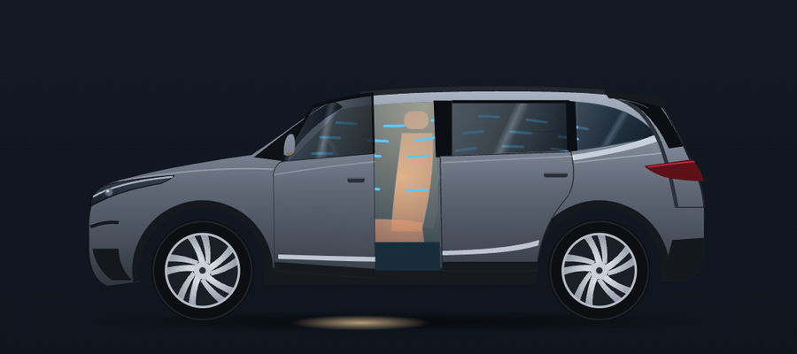
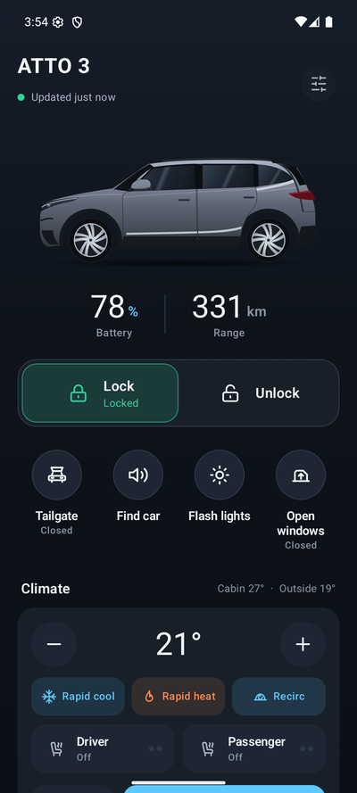
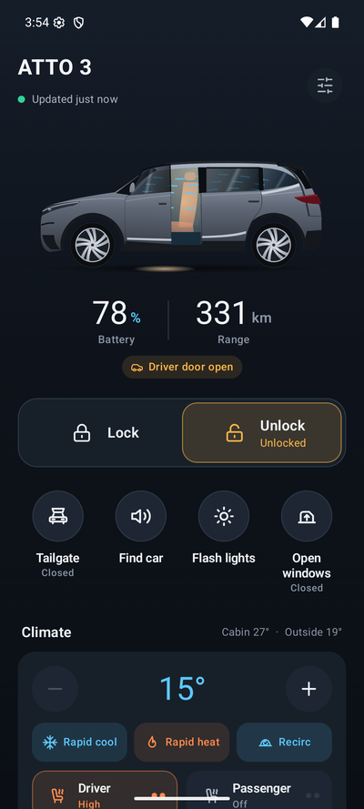
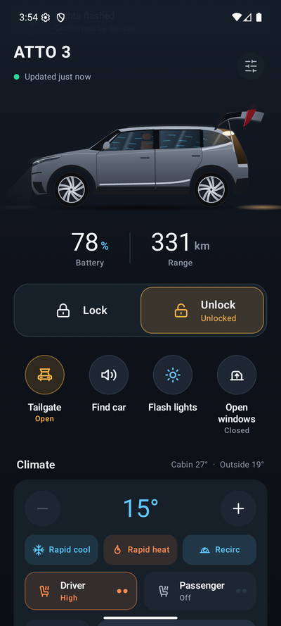
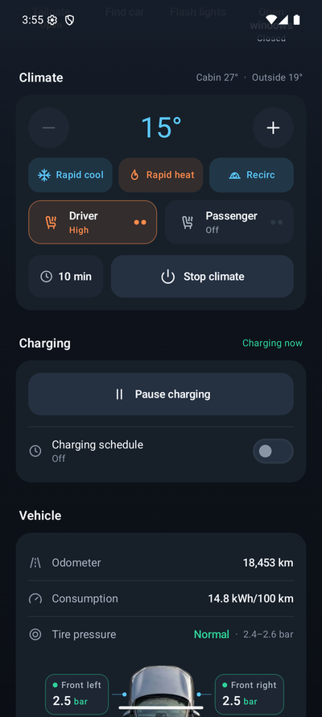
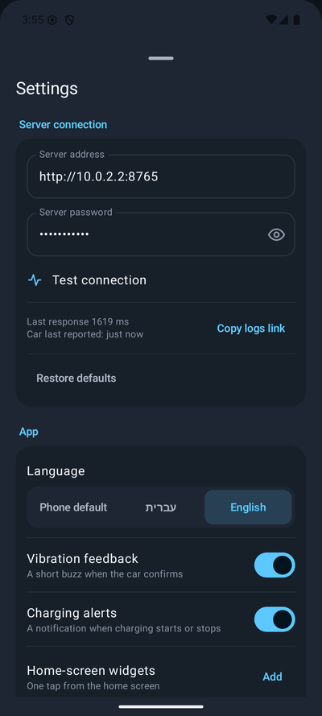
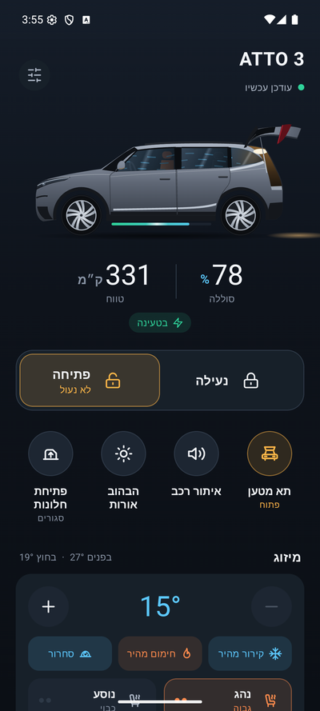
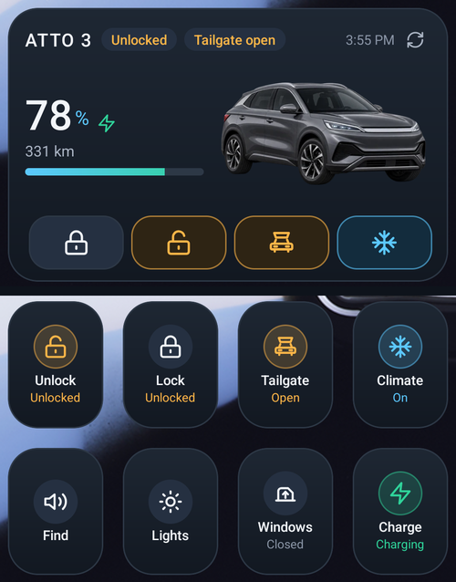
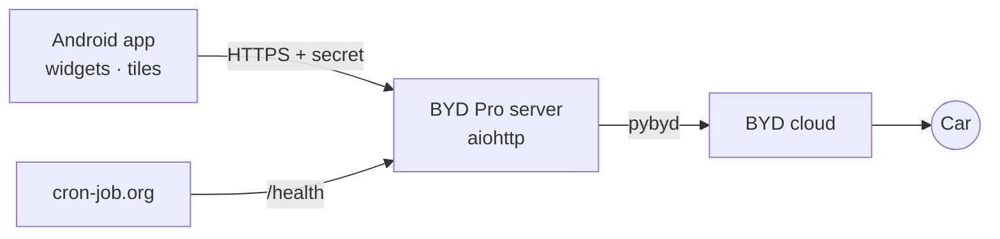

<div align="center">

# BYD Pro

**Remote control for the BYD ATTO 3: an Android app with a live, animated car, home-screen widgets, quick-settings tiles and a Wear OS companion, backed by a small Python server that talks to the BYD cloud.**




</div>

---

## What it does

BYD Pro turns a phone into a fast, honest remote for the car. Every button shows *Sending…* while the car works on it, then flips to its next action. A banner confirms the car's own answer. The car picture at the top shows the car's real state, not a decoration.

### The car picture

The ATTO 3 is drawn in code, side view, and split into moving parts:

- **Doors** swing open toward you. The cabin lights up and the ground under the door glows.
- **Windows** slide down into the doors and back up.
- **Tailgate** lifts on its hinge, with the cargo bay lit and a strut.
- **Mirrors** fold along the doors while the car is locked.
- **A/C** airflow runs through the cabin: blue when cooling, orange when heating. A heated seat glows.
- **Battery** strip under the floor fills to the charge level and pulses while charging.
- **Lights** fire only for *Flash lights* and *Find car*, with a beam on the road. *Find car* adds horn rings.
- **Far-side doors:** if only a passenger-side door is open, the car turns around: it closes this side, turns, then opens.

### Controls

| | |
|---|---|
| **Lock toggle** | One switch everywhere (app, widgets, tiles, watch): it shows the last known state and a tap does the opposite; an unknown state locks |
| **Tailgate, windows** | One-tap toggles; windows only ever *close* when their state is unknown |
| **Find car, flash lights** | Horn and lights, or lights only |
| **Climate** | *Quick Cool* / *Quick Heat* in one tap, or 15–31 °C, run time 10–30 min and recirculation; a temperature change while running waits for *Update to 23°* instead of sending on its own |
| **Seat heating** | Driver and passenger, three levels; taps are batched into one command |
| **Charging** | Start, pause (verified with the car), schedule: stop at / start at / between, with optional start and finish notifications |
| **Tyres** | Pressure per axle, summarised in one line ("OK · 2.4–2.6 bar") |

### Widgets, tiles and shortcuts

- **1×1 widgets** (lock toggle, tailgate, climate, Quick Cool, Quick Heat, find, lights, windows, charge) that adapt to the cell: icon only, icon and name, or icon, name and state. Quick Cool and Quick Heat ask for confirmation first.
- **Resizable dashboard widget** with battery, range, a live status chip and four actions.
- Widgets can be added straight from *Settings → Home-screen widgets*.
- **Quick-settings tiles** for lock and unlock, and **launcher shortcuts**.
- Widget and tile taps run as a short foreground service, so phone battery savers (OnePlus, Xiaomi, Samsung…) can't hold them back. A tap that would reach the car late is dropped: after 45 s for unlock, tailgate, windows, climate and horn; after 10 min for anything.

### Wear OS watch

- A watch app synced through the phone (Wearable Data Layer): the lock toggle, tailgate, climate, and a tile.
- The phone acknowledges a tap at once; *No answer from the phone* appears only when there really is no link (8 s).
- The command's progress (*Sending…*, *Done*, *Failed*) shows at the top and on the tile.

### Built to be light on both batteries

- No polling. One optional daytime check every 2 hours (08:00–20:00, at most six reads a day) notifies when the car was left unlocked or with a door, window or the tailgate open, once per change. It can be turned off in Settings.
- The server counts every car read, command and byte it exchanges with BYD; *Settings → Car data today* shows it (for example "7 reads · 3 commands · ~60 KB").
- The app reads the car when it opens; the server answers from a short cache, so the car isn't woken for every glance.
- Looping animations run only while the car picture is on screen.

### Hebrew and English

Hebrew-first (right-to-left) with a complete English UI. Language can be switched in the app.

## Screenshots

<sub>From version 2.6. Version 2.8 moved the app and widgets to a light sky theme; the watch stays dark.</sub>

<table>
  <tr>
    <td align="center"><br><sub>Home</sub></td>
    <td align="center"><br><sub>Door open, cooling, heated seat</sub></td>
    <td align="center"><br><sub>Tailgate open, lights flashing</sub></td>
  </tr>
  <tr>
    <td align="center"><br><sub>Climate, charging, tyres</sub></td>
    <td align="center"><br><sub>Settings</sub></td>
    <td align="center"><br><sub>Hebrew (RTL)</sub></td>
  </tr>
</table>

<p align="center"></p>

## How it works



**State colours are the same everywhere** (app, widgets, tiles, watch): blue = locked / closed / running / done, red = unlocked / open / failed, grey = off. A command on its way is neutral, and *sent, waiting for the car* is amber, so neither reads as a state.

The server keeps **one warm BYD session** for its whole life. Login, vehicle lookup, PIN check and capability fetch happen once at boot, never on a button press. On top of that session:

- **Commands are sent once.** pybyd would resend a slow or refused command up to three times, which could sound the horn twice. Here every command goes out once and is checked every 0.8 s.
- **Commands queue and run one at a time,** in the order they were tapped, from any entry point (app, widget, tile, watch). A double tap is one command, and a dropped connection never makes the server resend, so the tailgate can't close itself again and the horn never sounds twice.
- **Honest outcomes:** *done*, *sent, waiting for the car*, *not sent* or *the car refused*. When the answer is unclear the app checks with the car and updates on its own.
- **A sleeping server is woken first** (*Waking the server…*) and only then is the command sent.
- **Confirmed effects are held for 60 s**, so a slow car report can't flip a button back.
- **Status comes from a 60 s cache**, keyed to when the car itself last reported, not to when a command changed the cache. An empty report from a sleeping car is ignored.
- **The A/C shows as off once its run time is over**, with no extra car read.
- **"Pause charging" is checked with the car**, because the BYD cloud can only re-enable the schedule. If the car is inside its charging window and keeps charging, the app says so.
- **Logs:** every request is one readable line in `/logs`. A *logs-only* key (an HMAC of the secret) lets you share the logs without sharing the password.

## Repository layout

```
android/          Android app (Kotlin, Jetpack Compose, Material 3)
  app/src/main/java/com/example/byd/
    data/         repository, API client, snapshot model, prefs
    ui/           dashboard, animated car (CarSideView), settings, charging
    widget/       1x1 + dashboard widgets
    tile/         quick-settings tiles
    work/         command service (widgets/tiles) and job fallback
    system/       charging alerts, language, haptics, watch sync
    bus/          one command bus shared by the app, widgets, tiles and watch
  wear/           Wear OS app (Compose for Wear OS), synced through the phone
server/
  main.py         entry point
  bydbridge/      the server (aiohttp + pybyd): routes, auth, command pipeline, session, state, data usage
  API.md          the full HTTP contract (server 3.0)
  tests/          fake car, end-to-end and failure-mode tests (no real network)
docs/
  screenshots/
  design/car-side-view.html   interactive prototype of the car picture
render.yaml       one-click Render deploy
```

## Getting started

### 1. Server

You need a BYD app account with remote control enabled, and its 6-digit control PIN.

| Variable | |
|---|---|
| `BYD_USERNAME` | BYD app email |
| `BYD_PASSWORD` | BYD app password |
| `BYD_CONTROL_PIN` | 6-digit remote-control PIN |
| `AUTH_SECRET` | Any long random string. The app sends it with every request; without it the server refuses everything. |
| `CAR_TIMEZONE` | Optional. IANA zone for charging schedules, default `Asia/Jerusalem`. |
| `BYD_MQTT` | Optional. Live push from the car, on by default; `0` turns it off. |
| `PORT` | Optional. Default `10000`. |

**Run locally**

```bash
cd server
pip install -r requirements.txt
export BYD_USERNAME=... BYD_PASSWORD=... BYD_CONTROL_PIN=... AUTH_SECRET=...
python main.py
```

**Deploy on Render.** Use the included [`render.yaml`](render.yaml) (New → Blueprint), or create a Python web service by hand:

1. Root directory `server`.
2. Build command `pip install -r requirements.txt`, start command `python main.py`.
3. Add the environment variables above.

Pick the region closest to BYD's servers; for Europe that's Frankfurt. On the free plan, have [cron-job.org](https://cron-job.org) call `https://<your-service>/health` every 10 minutes so the instance stays warm. `/health` never touches the car.

### 2. App

Open `android/` in Android Studio (AGP 9, JDK 17+), or build from the command line:

```bash
cd android
./gradlew assembleRelease
```

The server address and secret can be typed in *Settings* on first launch. They can also be baked into the build through `android/local.properties` (not committed):

```properties
byd.serverUrl=https://your-service.onrender.com
byd.serverSecret=<your AUTH_SECRET>
```

The release build is signed with the local debug key so it installs directly. For anything beyond personal use, set up your own signing config.

## API

All routes take `Authorization: Bearer <AUTH_SECRET>`, or `?secret=` in a browser. Every response includes the car's current state. The complete contract (request ids, revisions, job states, errors) is in [`server/API.md`](server/API.md); the main routes:

| Route | Does |
|---|---|
| `GET /status` (`?fresh=1`) | State from cache, or a live read |
| `/lock`, `/unlock` | |
| `/trunk-toggle` | Opens if closed, closes if open |
| `/ac?temp=22&mins=15&air=recirc` | Climate on (`air=fresh` for outside air) |
| `/ac-off` | Climate off |
| `/locate`, `/flash` | Horn and lights, lights only |
| `/windows-close`, `/windows-vent` | |
| `/seat?driver=2&passenger=0` | Seat heating, 0–2 |
| `/charge-now`, `/charge-pause` | |
| `/charge-schedule?mode=window&start=23:00&end=07:00` | `mode=window`, `start_only` or `stop_only`; `enabled=false` turns it off |
| `/logs`, `/info` | Logs and diagnostics; also accept the logs-only `?key=` |
| `/health` | Keep-alive, no auth, never touches the car |

## Testing without a car

`server/tests` replaces pybyd's client with a fake car and blocks every connection except localhost, so nothing can reach the real vehicle.

```bash
cd server/tests
python test_server.py      # 79 end-to-end checks
python test_reliability.py # 96 failure-mode checks: dropped replies, double taps, queued commands, a waking server
python run_dummy.py        # local server on :8765 for the emulator
```

Build the app against it with:

```bash
./gradlew assembleRelease -PbydServerUrl=http://10.0.2.2:8765 -PbydServerSecret=test-secret
```

## Security notes

- Credentials come only from the environment. Without `AUTH_SECRET` the server refuses every request.
- Don't share the server URL together with `?secret=`. That secret can unlock the car; share the logs-only key instead.
- Commands are never retried silently, by the server or by the phone's HTTP client. A lost reply shows *not confirmed* and re-reads the car.

## Credits

- [pybyd](https://pypi.org/project/pybyd/) is the BYD cloud client this project builds on.
- The car illustration is drawn in code. The vehicle photos used in the widget and tyre diagram are BYD's and appear for illustration only.

## Disclaimer

This is an independent project. It is not affiliated with, endorsed by or supported by BYD. Remote commands act on a real vehicle; use at your own risk.

## License

[MIT](LICENSE) © 2026 Hananel Sabag
